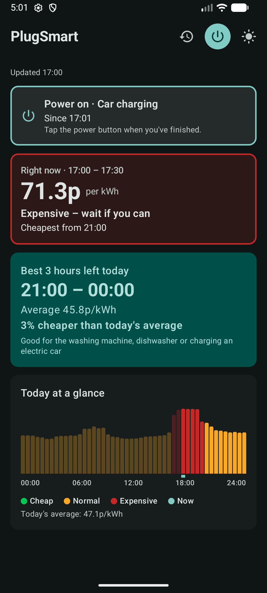
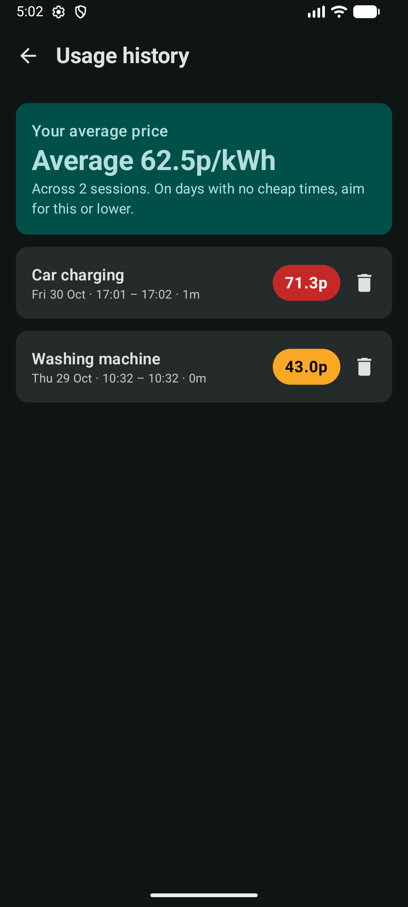

# Design – PlugSmart

## App Overview

- **Developer:** Owen Garden – 2309802
- **App Title:** PlugSmart
- - **Purpose:** Agile electricity prices change every half hour, so it's hard to know when to run appliances. PlugSmart shows the cheapest times and tracks what users paid, helping them save money and shift use to off-peak hours, when the grid is often greener. Supports [UN SDG 7 (Affordable and Clean Energy)](https://sdgs.un.org/goals/goal7).

**Core functionalities**

- Today's half-hourly prices, colour-coded cheap/normal/expensive, with the current price and the cheapest 3 hours left – *Must 1–2, Should 4*
- Power button records what was used (defaults or custom text) and the average price paid – *Must 2*
- History screen lists past sessions, a personal average price, and lets entries be removed – *Should 1, 3*
- Works offline from prices saved in Room – *Could 6*
- Downloads prices daily in the background – *Could 7*
- Keeps state on rotation and shows loading, offline and error messages – *Must 3, Should 2, 5*

## UI/UX Design & The View Layer

**Screenshots**

| Today | History                              |
|---|--------------------------------------|
|  |  |

**Compose UI structure**

- **Today:** `Scaffold` and `TopAppBar` (history, power and theme buttons), then a `LazyColumn` of `ActiveSessionCard`, `NowCard`, `BestTimeCard` and `DayPriceChart`. `StartSessionDialog` uses `FilterChip`s and an `OutlinedTextField`.
- **History:** `LazyColumn` of an average `Card` and `SessionRow`s, each with a delete `IconButton` and confirm `AlertDialog`.

**State hoisting**

`TodayContent`, `HistoryContent` and all components are stateless, receiving data and callbacks. State is hoisted to the ViewModels; the theme is hoisted to `MainActivity`.

**Responsive design**

Both screens are scrolling `LazyColumn`s that fill the width, so they work in portrait and landscape. Material 3 components, colours and typography are used throughout.

## MVVM Architecture & State Management

**ViewModels** expose a `StateFlow` and survive rotation:

- `TodayViewModel` → `TodayUiState`: prices, current slot, best window, loading/offline/error flags, active session, dialog state.
- `HistoryViewModel` → `HistoryUiState`: finished sessions and the personal average.

**Unidirectional data flow (turning the power off)**

1. The user taps the power button; `TodayScreen` calls `onPowerClick()`.
2. `TodayViewModel` calls `UsageRepository.finish()`, which works out the time-weighted price paid and saves it to Room.
3. The ViewModel updates `_uiState` with the finished session.
4. `TodayScreen` recomposes and shows the result dialog.

**Data layer**

`PriceRepository` downloads today's and tomorrow's prices with Retrofit and saves them to Room. If offline, it uses today's saved prices, then an older day as a guide. `UsageRepository` manages sessions. `PriceSyncWorker` (WorkManager) refreshes prices daily at around 5pm when online.

**Room entities**

```kotlin
@Entity(tableName = "prices")
data class PriceEntity(
    @PrimaryKey val startMillis: Long,
    val endMillis: Long,
    val pricePence: Double
)

@Entity(tableName = "usage_sessions")
data class UsageSessionEntity(
    @PrimaryKey(autoGenerate = true) val id: Long = 0,
    val label: String,
    val startMillis: Long,
    val endMillis: Long?,          // null while the power is on
    val averagePence: Double?,
    val dayAveragePence: Double?
)
```

**API JSON (received)**

`GET https://api.octopus.energy/v1/products/AGILE-24-10-01/electricity-tariffs/E-1R-AGILE-24-10-01-P/standard-unit-rates/`

```json
{
  "results": [
    {
      "value_inc_vat": 12.1,
      "valid_from": "2026-10-28T12:30:00Z",
      "valid_to": "2026-10-28T13:00:00Z"
    }
  ]
}
```

## Navigation & Resilience

**Navigation:** Navigation Compose with route strings `"today"` (start) and `"history"`. No arguments are passed; both screens read from the repositories.

**Error handling**

- Network failure: `PriceRepository` catches `IOException`/`HttpException` and falls back to Room; the UI shows an offline banner.
- No saved data: the ViewModel sets `hasError` and shows a Retry button.
- Background sync failure: the worker retries with backoff.
